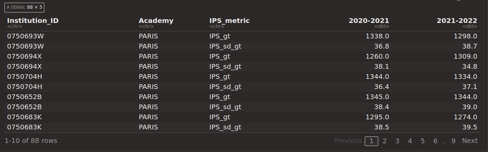

# Background

In this homework assignment, we will examine the Social Position Index (IPS, for *Indice de Positionnement Social*, its French name). This is a synthetic index that helps to understand the social status of students based on the professions and social categories (PCS) of their parents. For each PCS, the numerical value of the IPS represents a quantitative summary of a set of socio-economic and cultural attributes related to academic success. The social level of a school is assessed by calculating the average IPS of the students enrolled there.

The social heterogeneity index of a school corresponds to the standard deviation of the IPS of its students. The higher it is, the more diverse the social profile of the students. This index has been calculated since the 2019 school year, only for secondary education institutions.

The data come from the open data platform of Education, Sports, and Youth and were retrieved [here](https://data.education.gouv.fr/api/explore/v2.1/catalog/datasets/fr-en-ips_lycees/exports/csv?lang=fr&timezone=Europe%2FBerlin&use_labels=true&delimiter=%3B) in CSV format.

We will start by describing the data using some descriptive statistics before addressing two questions:

- Is the IPS higher in certain regions?
- Has the Affelnet reform in Paris had an impact on the IPS of high schools?

# Session Setup (1 pt)

Start your analysis by loading useful packages.

```{python}
#| eval: false
import ...
```

# Import the data (1 pt)

The data are stored in two flat tsv files ([ips_data](data/ips_data.tsv) and [academy_data](data/academy_data.tsv)) located on the website. Import them as `ips_data` and `academy_data`. Each dataset consists of tabular data with several columns.

`academy` has 6 variables:

-   `Academy`: academy (administrative division for higher education) of the high school
-   `Dept`: departement (medium scale administrative division) of the high school
-   `Dept_code`: departement number
-   `Institution`: institution name
-   `Institution_ID`: high school unique ID
-   `Sector`: whether the school is *public* or *privé sous contrat*
-   `City`: city name

`ips_data` has 7 variables:

-   `Academic_Year`: academic year
-   `Institution_ID`: high school unique ID
-   `IPS`: mean IPS for students in both *Voie Générale et Technologique* (hereafter GT) and *Voie Professionnelle* (hereafter PRO)
-   `IPS_gt`: mean IPS for GT students
-   `IPS_pro`: mean IPS for PRO students
-   `IPS_sd_gt`: standard deviation of the IPS for GT students
-   `IPS_pro_gt`: standard deviation of the IPS for PRO students

# Missing data (2 = 1+1 pt)

Inspect the data to find missing values. How many high school(s) have any missing value for the `IPS` value ? And for the `IPS_gt` and `IPS_pro` values ?

Count the fraction of missing values for `IPS_sd_gt` (and then for `IPS_sd_pro`) for each academic year. Comment the results.

# Manipulate the data (3 = 0.5+1+1+0.5 pt)

Some high schools can change name (but not their unique ID). How many high schools have one more than one names ?

```{python}
#| eval: false
...
```

Clean `academy_data` by removing the duplicates. If a high-school has multiple names, keep only the first that appears in the dataset.

```{python}
#| eval: false
...
```

Join the two datasets (`ips_data` and `academy_data`) in a single dataset called `data` and order the record by year, department and high school name.

```{python}
#| eval: false
...
```

Which records (row number) correspond to the Parisian high school "Henri IV"?

```{python}
#| eval: false
...
```

Add a `public_type` column to the data frame that characterizes the students in the high school. It should take 3 values:

-   `"gt"` if the school only has GT students
-   `"mixed"` if the school only has both GT students and PRO students
-   `"pro"` if the school only has PRO students

You can look at the `if_else()` and/or `case_when()` functions to help you.

```{python}
#| eval: false
...
```

Recode the `Sector` column so that the two values it takes are:

-   `"public"` if the high school is public

-   `"private"` if the high school is private

```{python}
#| eval: false
...
```

# Check the data (3 = 0.5+0.5+1+1 pt)

How many records do we have in `data` ? How does it compare to the number of records in `ips_data` ? Explain why.

```{python}
#| eval: false
...
```

How many high schools appear in the dataset ?

```{python}
#| eval: false
...
```

How many high schools have records for the 6 academic years ?

```{python}
#| eval: false
...
```

Select parisian public high schools that only have GT students and for which we have 6 years of data and keep only the informative columns. Store the results in a new variable `paris_data`.

```{python}
#| eval: false
...
```

# Explore the data (10 = 5 + 5 pt)

In the following, we're interested in the social heterogeneity of high schools across academy.

## Public and private schools (5 = 1 + 2 + 2 pt)

### Mean IPS values

Plot the mean `IPS` for each year in each academy in GT high schools. Distinguish the public and private highschools. Use informative title and axis labels and use facets to separate to separate the different years. Comment the results.

```{python}
#| eval: false
...
```

### Spread of IPS values

The average values can hide large discrepancies. Focus on the academic year 2016-2017 for GT schools and show the spread of IPS scores, again separating public and private high schools, in each academy. Use an appropriate visualisation and informative axis labels and justify your choice. Comment the result.

```{python}
#| eval: false
...
```

### Comparing public and private IPS

We're going to focus on GT high schools in the Academy of Versailles for the last academic year (2021-2022). It's often claimed that private high schools serve a more privileged audience that public ones. Compare the IPS of public and private high schools to confirm or infirm that claim.

Specify the test and model you use.

```{python}
#| eval: false
...
```

## Affelnet reform in Paris (5 = 2+1.5+1.5 pt)

### Graphical assessment

The Affelnet reform, introduced in Paris in 2021, aims at reducing the segregation of students in public high schools by changing the accession. It should in principle:

-   reduce the spread of IPS and homogeneize schools' IPS across the mean region mean IPS
-   increase the standard deviation of the IPS in each school as they should serve students with more diverse background.

Going back the `paris_dataset`, filter and pivot the data to make it look like that:



I removed the columns `Institution` and `City` from the screen shot but you should keep them

```{python}
#| eval: false
...
```

Plot the IPS scores (not the IPS_sd) of 2021-2022 against those of 2020-2021.

```{python}
#| eval: false
...
```

Now plot the social heterogeneity scores of 2021-2022 against those of 2020-2021. 

```{python}
#| eval: false
...
```

It looks like schools who add a low IPS in 2020 have a higher IPS in 2021 and vice versa and IPS heterogeneity increased between 2020 and 2021. To make easier to see, add a `change` column in the dataset that records the change in the IPS metric between 2021 and 2020.

```{python}
#| eval: false
...
```

### Change in IPS score (1.5 pt)

We're now going to regress `change` against the 2020 score.

```{python}
#| eval: false
...
```

Use `summary()` on your linear model and interpret the results. Did the reform impact the IPS score of public highschools ? Back your conclusion with numerical values. You can also use a graphic to illustrate your conclusion.

```{python}
#| eval: false
...
```

### Change in social heterogeneity

Test whether social heterogeneity increased or decreased after the reform. Specify the test and model you use.

```{python}
#| eval: false
...
```

What do you conclude ?
