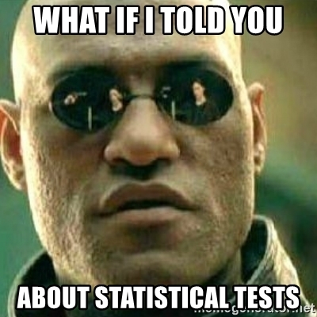
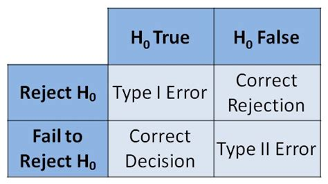
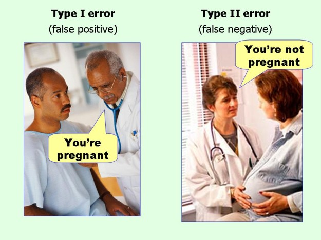
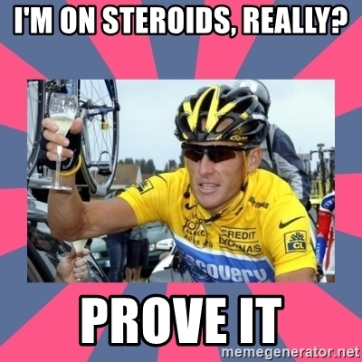
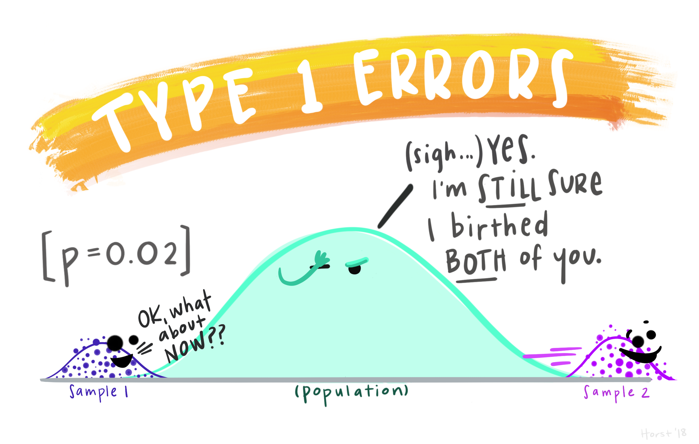
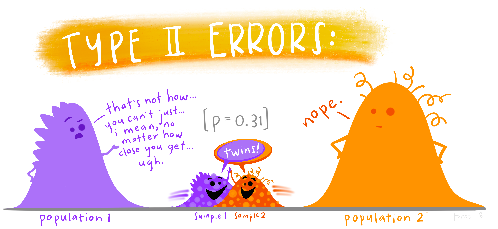

```{r setup, include=FALSE,}
knitr::opts_chunk$set(echo = FALSE,comment=NA,message=FALSE,warning = FALSE)
library(ggplot2)
library('gridExtra')
library(dplyr)
DisplayVect <- function(v,NbItemPerLine=6,Max=30,Round=3){
  lv <- length(v)
  Max <- min(lv, Max)
  v <- v[1:Max]
  for (ii in 1:(lv%/%NbItemPerLine)){
    cat(round(v[((ii-1)*NbItemPerLine+1):(ii*NbItemPerLine)],Round),'\n')
  }
  if (lv%%NbItemPerLine !=0){
    cat(round(v[(lv- lv%%NbItemPerLine + 1):lv],Round),'\n')
  }
}
library(patchwork)
```

```{r xaringan-scribble, echo=FALSE}
# xaringanExtra::use_scribble()
```

---

## Main Idea

Some research directions can be formulated as .blue[questions] with a yes / no answer: 

- Is the expression of gene HER2 large in breast cancer ?
- Is a new variety of tomato more resistant to mildew than the previous one ?
- Is food cheaper in China than in France ?

--

You collect .alert[noisy data] about the problem and want to give an *evidence based* .blue[answer] to the question

--

```{r, echo = FALSE, out.width="300px", fig.align='center'}

```

---

## When should you use a test ?

* You have a .alert[yes/no] question

* You have .alert[data] related to the question

* The data can be .alert[modeled] as the result of some .alert[random variable]

* The question can be framed in terms of .alert[parameters] of the distribution

--

.pull-left[
You can either:
- **reject** the null hypothesis: observed patterns are unexpected under your assumptions
- **retain** the null hypothesis: observed patterns are expected under your assumptions
  - .red[**Does not imply that your assumptions are true**]
]

--

.pull-right[
.red[**Remember that you don't accept the null hypothesis, you fail to reject it.**]
]

---
## Four elements of a test


.pull-left-70[
- **Data:** 
    * $y_1, ..., y_n$ realisation of r.v. $Y_1, ..., Y_n$
- A statistical **model**: 

    * distribution of  $Y_1,..., Y_n$ depending on some parameters $\theta$

- An **assumption**: 

    * A statement about $\theta$. 
    * This is the so called $H_0$ hypothesis that you usually want to reject, $H_1$ being the alternative

- A **decision rule** 

  	* If $T=f(Y_1,..., Y_n)$ is a test statistic
  	* $R$  is subset of values for $T$ that is unlikely if $H_0$ is true
]

---
## An example with babies

- **Data**: biological sex of children born in 2022 (most recent year available) in France (from [INED and INSEE](https://www.ined.fr/fr/tout-savoir-population/chiffres/france/naissance-fecondite/naissances-sexe/))
  - 351 296 `r emo::ji("boy")` / 335 268 `r emo::ji("girl")`

- **Model**: 
  - The sex of a newborn is $\sim \mathcal{B}(p)$, a Bernoulli of parameter $p$ (where 1 stands for girls and 0 for boys)
  - Sex of all children are i.i.d. (.alert[modeling assumption])
  
- **Null Hypothesis**
  - There is an equal chance of being born a boy or a girl $\Rightarrow p = 1/2$
  
- **Decision rule**
  - Test statistic: .alert[frequency] $\hat{p}$ of girls among children born in 2022
  - Reject $H_0$ if $\hat{p}$ is **too far** from $1/2$ 
  
--

.center[.alert[The hard work consists in quantifying what is *too far*]]

---
## Decision errors

The decision is based on .alert[noisy data] and so is .alert[error-prone]

```{r, echo = FALSE, out.width = "700px", fig.align='center'}

```

.footnote[Image from [whatilearned](https://whatilearned.fandom.com/wiki/Hypothesis_Testing)]

---
### Type I/ Type II error for pregnancy tests

```{r, echo = FALSE, out.width="700px", fig.align='center'}

```

---

### A few remarks

- Strong .alert[asymetry] between $H_0$ and $H_1$

- You want to accumulate sufficient evidence .alert[against] $H_0$. 

- Analogy with trials: $H_0$ is on trial, do you have enough proof to convict it? 

.center[
**Necessary trade-off** between type I and type II errors:
]
--

.pull-left-70[
- .alert[more stringent] criteria : 
  - less wrongful convictions (type I errors) 
  - more criminals released (type II errors, lack of power)
<br>
<br>
<br>
]

.pull-right-30[
```{r echo = FALSE, out.width="150px"}

```
]

--

.pull-left-70[
- .alert[less stringent] criteria: 
  - less criminals released (type II errors)
  - more wrongful convictions (type I error) 
]

.pull-right-30[
```{r echo = FALSE, out.width="150px"}

```
]

---

## Construction of a test

.pull-left-70[
- Start with an .alert[estimator] for the parameter of intercept:
    - Frequencies $F$ of girls among newborn
]

--

.pull-left-70[    
- Derive the .alert[distribution] of $F$ under $H_0$
    - For $n = 335 268 + 351 296$, using the gaussian approximation, we have 
    $$F \sim \mathcal{N}(1/2, p(1-p)/n) = \mathcal{N}(1/2, 1/4n) = \mathcal{N}(0.5, 3.6 \times 10^{-7})$$
]

.pull-right-30[
```{r echo = FALSE, fig.width = 5, fig.height=5, out.width="700px"}
n <- 335268+351296
x <- seq(0.495, 0.505, length.out = 101)
density <- dnorm(x, mean = 0.5, sd = sqrt(1/(4*n)))
plot(x = x, y = density, type = "l")
abline(v = c(0.4988173, 0.5011827), col = "blue", lty = 2)
```
]

--

.pull-left-70[
- Calibrate the .alert[region of unlikely values] under the null
    - With probability 0.95, $|F - 1/2| \leq 1.96 \times \sqrt{3.6\times 10^{-7}} = 0.0012$
    - $F \notin [0.4988, 0.5012]$ with probability at most 5%
]

--

.pull-left-70[
- Compare with the .alert[actual estimation]
    - Here $f = 335 268 / (335 268 + 351 296) = 0.488$
    - Unlikely if $p= 1/2$ $\Rightarrow$ reject $H_0$
    
]

---

## About the p-value

**Idea** Go one step further than **reject / retain** and assess the .alert[significance] of the observed statistic

.pull-left-50[
- $|F - 1/2|$ .alert[unlikely] to be higher than $0.0012$

- $|f - 1/2|$ .alert[actually] observed to be $0.012$
]

--

.pull-right-50[
```{r, echo = FALSE, fig.width=5, fig.height=3.9, out.width="700px"}
n <- 335268+351296
x <- seq(0.485, 0.515, length.out = 1001)
sdev <- sqrt(1/(4*n))
density <- dnorm(x, mean = 0.5, sd = sdev)
a <- qnorm(p = 0.025, mean = 0.5, sd = sdev) 
b <- qnorm(p = 0.975, mean = 0.5, sd = sdev) 
df <- tibble(x = x, 
             d = density, 
             side = case_when(
               x < a ~ "low", 
               x > b ~ "high",
               TRUE ~ "center"))
ggplot(df, aes(x = x, y = d)) + 
  geom_line() +
  geom_area(aes(y = d, fill = side)) + 
  scale_fill_manual(values = c(low = "darkred", center = "transparent", high = "darkred"), guide = "none") + 
  geom_vline(xintercept = c(a, b), color = "darkred", linetype = 2) +
  annotate(x = 0.5, y = dnorm(a, mean = 0.5, sd = sdev), hjust = 0.5, vjust = 0, geom = 'text', label = "alpha == 0.05", parse = TRUE, color = "darkred") +
  annotate(x = a, y = 250, hjust = 1.1, vjust = 0, geom = 'text', label = "f == 0.4988", parse = TRUE, color = "darkred") +
  annotate(x = b, y = 250, hjust = -0.1, vjust = 0, geom = 'text', label = "f == 0.5012", parse = TRUE, color = "darkred") +
  geom_vline(xintercept = c(0.488, 0.512), color = "red", linetype = 2) +
  annotate(x = 0.488, y = 0, hjust = -0.1, vjust = -0.5, geom = 'text', label = "f == 0.488", parse = TRUE, color = "red") +
  theme_bw() + 
  # annotate(x = t, y = 0.05, hjust = -1, vjust = 0, geom = 'text', label = "p", parse = TRUE, color = "red") + 
  NULL
```
]

--

.pull-left-50[
- How likely are we to observe such deviations if $p=1/2$? 
]

--

.pull-left-50[
$$
\begin{align}
p &= P_{H_0}(|F - 1/2| > |f - 1/2|) \\
& = P_{H_0}(|F - 1/2| > 0.012) \\
& = P_{H_0}(F < 0.488) + P_{H_0}(F > 0.512) \\
& \simeq 5.5 \times 10^{-89}
\end{align}
$$
- Not only unlikely but .alert[insanely] unlikely !!!
]

---

## A less extreme example

The number of men / women aged 0-19 years in the Paris city (data from [INSEE](https://www.insee.fr/fr/statistiques/2011101?geo=DEP-75#figure-1-5)): 

198 110 `r emo::ji("boy")` / 198 905 `r emo::ji("girl")`


.pull-left[
Repeating the process, we find 

- $F \sim \mathcal{N}(1/2, 6.3\times 10^{-7})$

- $|F - 1/2|$ unlikely to be higher than $0.15$%

- $|f - 1/2|$ actually observed to be $0.1$%

- How extreme is that deviation ? 

$$
\begin{align}
p &= P_{H_0}(|F - 1/2| > |f - 1//2|) \\
& = P_{H_0}(|F - 1/2| > 0.001) \\
& = P_{H_0}(F < 0.499) + P_{H_0}(F > 0.501) \\
& \simeq 20.76\%
\end{align}
$$
- Not very extreme, you expect it to observe 1 out of 5 times. 
]

.pull-right[
```{r, echo = FALSE, fig.width=5, fig.height=3.9, out.width="700px"}
n <- 198110+198905
x <- seq(0.495, 0.505, length.out = 1001)
sdev <- sqrt(1/(4*n))
density <- dnorm(x, mean = 0.5, sd = sdev)
a <- qnorm(p = 0.025, mean = 0.5, sd = sdev) 
b <- qnorm(p = 0.975, mean = 0.5, sd = sdev) 
f1 <- 1 - 198905/n; f2 <- 198905/n;  
df <- tibble(x = x, 
             d = density, 
             side = case_when(
               x < f1 ~ "very_low",
               x < a ~ "low", 
               x > f2 ~ "very_high",
               x > b ~ "high",
               TRUE ~ "center")
)
ggplot(df, aes(x = x, y = d)) + 
  geom_line() +
  geom_area(aes(y = d, fill = side)) + 
  scale_fill_manual(values = c(very_low = "red", low = "darkred", center = "transparent", high = "darkred", very_high = "red"), guide = "none") + 
  geom_vline(xintercept = c(a, b), color = "darkred", linetype = 2) +
  annotate(x = 0.5, y = dnorm(a, mean = 0.5, sd = sdev), hjust = 0.5, vjust = 0, geom = 'text', label = "alpha == 0.05", parse = TRUE, color = "darkred") +
  annotate(x = 0.5, y = dnorm(f1, mean = 0.5, sd = sdev), hjust = 0.5, vjust = 0, geom = 'text', label = "p == 0.103", parse = TRUE, color = "red") +
  annotate(x = a, y = 300, hjust = 1.1, vjust = 0, geom = 'text', label = paste("f =", round(a, 3)), color = "darkred") +
  annotate(x = b, y = 300, hjust = -0.1, vjust = 0, geom = 'text', label = paste("f =", round(b, 3)), color = "darkred") +
  geom_vline(xintercept = c(f1, f2), color = "red", linetype = 2) +
  annotate(x = f1, y = 200, hjust = 1.1, vjust = -0.5, geom = 'text', label = paste("f =", round(f1, 3)), color = "red") +
  annotate(x = f2, y = 200, hjust = -0.1, vjust = -0.5, geom = 'text', label = paste("f =", round(f2, 3)), color = "red") +
  theme_bw() + 
  # annotate(x = t, y = 0.05, hjust = -1, vjust = 0, geom = 'text', label = "p", parse = TRUE, color = "red") + 
  NULL
```
]


---
## Equality of means

.pull-left[
Let's go back to the `Agro` dataset.
```{r, eval = TRUE}
set.seed(42)
n <- 731
Agro <- tibble(Gender = sample(c("F", "M"), size = n, replace = TRUE), 
               Age    = sample(19:23, size = n, prob = 5:1, replace = TRUE), 
               Year   = case_when(
                 Age == 19 ~ "1A", 
                 Age >= 22 ~ "3A",
                 Age == 20 ~ sample(c("1A", "2A"), size = n, replace = TRUE), 
                 Age == 21 ~ sample(c("2A", "3A"), size = n, replace = TRUE), 
               ),
               Height = if_else(Gender == "M", rnorm(n = n, mean = 178, sd = 4), rnorm(n = n, mean = 170, sd = 4)), 
               Weight = runif(n, min = 18, max = 25) * (Height/100)^2 %>% round(2))
Agro <- Agro %>% select(all_of(c('Height','Weight','Age', 'Year', 'Gender')))
head(Agro)
```

Remember that we found different distributions between Male and Female students. 
]

--

.pull-right[
```{r}
TH <- theme(axis.text=element_text(size=15),
      axis.title=element_text(size=25),
      axis.title.y=element_blank(),
      plot.title=element_text(size=15),
      strip.text.x = element_text(size = 20),
      legend.text=element_text(size=18),
      legend.title = element_text(size = 20))
# ggsave(paste0(Rep,'Slides/Figures/HistHeight2.pdf'))
Hist3 <- ggplot(Agro, aes(x=Height, color=Gender, fill=Gender)) +
  geom_histogram(position="identity", alpha=0.7,bins=30) +
  theme_minimal() + 
  scale_fill_viridis_d(aesthetics = c("fill", "color")) + 
  theme(legend.position = "inside", legend.position.inside = c(1, 1), 
        legend.justification = c(1,1)) +
  TH
```

```{r, out.height="400px"}
Hist3
```
]


---
## What could go wrong ?

.pull-left[
```{r, echo = FALSE, out.height="400px", fig.align='center'}

```
]

.pull-right[
```{r, echo = FALSE, out.height="400px", fig.align='center'}

```
]

---
## Two-sample test

- **Data**: Heights from female $(X_1, \dots, X_{n_1})$ and male $(Y_1, \dots, Y_{n_2})$ students in the agro dataset (with $n_1 = 362$ and $n_2 = 369$)

- **Model**: 
  - The height $X_i$ of female student $i$ is $X \sim \mathcal{N}(\mu_1, \sigma^2)$ and the height of male student $j$ is $Y_j \sim \mathcal{N}(\mu_2, \sigma^2)$ (.alert[we assume the same variance in both population])
  - All heights are independent (.alert[modeling assumption])
  
- **Null Hypothesis**
  - The mean height is the same for both male and female students $\Rightarrow  \mu_1 - \mu_2 = 0$
  
- **Decision rule**
  - Test statistic: Mean (scaled) height difference $t = \frac{\hat{\mu}_1 - \hat{\mu}_2}{\hat{\sigma}}$
  - Reject $H_0$ if $t$ is **too far** from $0$ 
  
--

.center[.alert[The hard work consists in quantifying what is *too far*], which requires knowing the distribution of $T$ under $H_0$.]

--

This is called an .red[equality of means] test.

---
## Distribution of $T$

The estimators of $\mu_1$ and $\mu_2$ are the usual suspects $\bar{X}$ and $\bar{Y}$. 

--

The estimate of $\sigma^2$ is slightly more involved and is a pooled version of the group-wise variance estimator

$$
S = \sqrt{\frac{(n_1 - 1)S^2_X + (n_2 - 1)S^2_Y}{n_1 + n_2 - 2}}
$$

where $S^2_X = \frac{1}{n_1 - 1} \sum_{i=1}^{n_1} (X_i - \bar{X})^2$ is the estimator of $\sigma^2$ using only the $X_i$ and likewise for $S^2_Y$.

--

Under $H_0$, we can show (with a bit of effort) that $T$ has a student distribution with $n_1 + n_2 - 2$ degrees of freedom. 

$$
T = \frac{\bar{X} - \bar{Y}}{S\sqrt{\frac{1}{n_1} + \frac{1}{n_2}}} \sim \mathcal{T}
$$

--

We can now use this distribution to build a rejection region and compute p-values. 

---
## Distribution and p-value

.pull-left[
```{r}
t.test(Height ~ Gender, data = Agro, var.equal = TRUE)
```
]

--

.pull-right[
```{r, echo = FALSE, fig.width=5, fig.height=3.9, out.width="700px"}
n <- 729
x <- seq(-30, 30, length.out = 1001)
density <- dt(x, df = n)
a <- qt(p = 0.025, df = n) 
b <- qt(p = 0.975, df = n) 
f1 <- -27.629; f2 <- -f1;  
df <- tibble(x = x, 
             d = density, 
             side = case_when(
               x < f1 ~ "very_low",
               x < a ~ "low", 
               x > f2 ~ "very_high",
               x > b ~ "high",
               TRUE ~ "center")
)
ggplot(df, aes(x = x, y = d)) + 
  geom_line() +
  geom_area(aes(y = d, fill = side)) + 
  scale_fill_manual(values = c(very_low = "red", low = "darkred", center = "transparent", high = "darkred", very_high = "red"), guide = "none") + 
  geom_vline(xintercept = c(a, b), color = "darkred", linetype = 2) +
  # annotate(x = 0.5, y = dnorm(a, mean = 0.5, sd = sdev), hjust = 0.5, vjust = 0, geom = 'text', label = "alpha == 0.05", parse = TRUE, color = "darkred") +
  # annotate(x = 0.5, y = dnorm(f1, mean = 0.5, sd = sdev), hjust = 0.5, vjust = 0, geom = 'text', label = "p == 0.103", parse = TRUE, color = "red") +
  # annotate(x = a, y = 300, hjust = 1.1, vjust = 0, geom = 'text', label = paste("f =", round(a, 3)), color = "darkred") +
  # annotate(x = b, y = 300, hjust = -0.1, vjust = 0, geom = 'text', label = paste("f =", round(b, 3)), color = "darkred") +
  geom_vline(xintercept = c(f1), color = "red", linetype = 2) +
  # annotate(x = f1, y = 200, hjust = 1.1, vjust = -0.5, geom = 'text', label = paste("f =", round(f1, 3)), color = "red") +
  # annotate(x = f2, y = 200, hjust = -0.1, vjust = -0.5, geom = 'text', label = paste("f =", round(f2, 3)), color = "red") +
  theme_bw() + 
  # annotate(x = t, y = 0.05, hjust = -1, vjust = 0, geom = 'text', label = "p", parse = TRUE, color = "red") + 
  NULL
```
]

---
## Permutational p-value

But what if we don't know the distribution of $T$ (or $\bar{X} - \bar{Y}$) under $H_0$?

--

.red[Estimate] it using .alert[simulations and resampling] !

--

.pull-left[
```{r, echo = FALSE, fig.align='center'}

```
]

--

.pull-right[
- Sample under $H_0$: 
  - Assign students to male or female randomly by shuffling labels (breaks down any association between height and gender)
- Compute $\Delta_{(1)} = \bar{X}_{(1)} - \bar{X}_{(1)}$ on the shuffled dataset
  - Difference expected *just by chance*
- Repeat many times to get $\Delta_{(1)}, \dots, \Delta_{(N)}$ (with $N$ large).
  - Typical range of differences expected *just by chance* under $H_0$
- Compare $\Delta$ to the distribution of $\Delta_{(i)}$
- Compute the p-value as
$$
p = \frac{1 + \\\#\\\{i \text{ s.t. } |\Delta_{(i)}| > |\Delta|\\\}}{N+1}
$$
]


---
## Permutational p-value (Cont'd)


.pull-left[
```{r}
p1 <- ggplot(Agro, aes(x=Height, color=Gender, fill=Gender)) +
  geom_histogram(position="identity", alpha=0.4,bins=30) +
  labs(title = "Original data") + 
  geom_vline(data = ~ . |> summarize(x = mean(Height), .by = Gender), aes(xintercept = x), 
             linewidth = 1) + 
  theme_minimal() + 
  scale_fill_viridis_d(aesthetics = c("fill", "color")) + 
  theme(legend.position = "none", axis.title.x = element_text(size = 15)) +
  TH
shuffle_p <- function() {
  p <- p1 + labs(title = "After shuffling")
  p$data <- p$data |> mutate(Gender = sample(Gender))
  p
}
(p1 + shuffle_p() + shuffle_p()) / (shuffle_p() + shuffle_p() + shuffle_p())
```
]

--

.pull-right[
```{r}
H0_dist <- purrr::map_dbl(1:9999, \(i) {
  with(Agro, {
    Gender <- sample(Gender)
    mean(Height[Gender == "F"]) - mean(Height[Gender == "M"])
  })
})
delta <- with(Agro, mean(Height[Gender == "F"]) - mean(Height[Gender == "M"]))
hist(H0_dist, main = "Distribution of Delta under H0 (9999 permutations)", xlab = "Delta", xlim = c(-10, 10))
abline(v = delta, col = "red")
text(x = delta, y = 1000, labels = "p = 1/10000", pos = 4, col = "red")
```
]

---

class: middle, inverse

## Summary

- #### Collect .alert[data] from a .alert[sample]

- #### Build a .alert[model] for your .alert[observations] with .alert[reasonable] assumptions

- #### State the .alert[question] (hypothesis) in terms of model .alert[parameter]

- #### Build a (good) .alert[estimator] for the parameter of interest

- #### Assess the .alert[uncertainty] of the estimator using .alert[confidence interval]

- #### .alert[Reject or retain] your research hypothesis based on the .alert[level] you want to achieve

- #### Assess the .alert[significance] of your result using .alert[p-values]

---

## 谢谢山东大学威海校区 🌊⛱️☀️🥟🍜

```{r echo = FALSE, out.width="500px", fig.align='center'}

```

