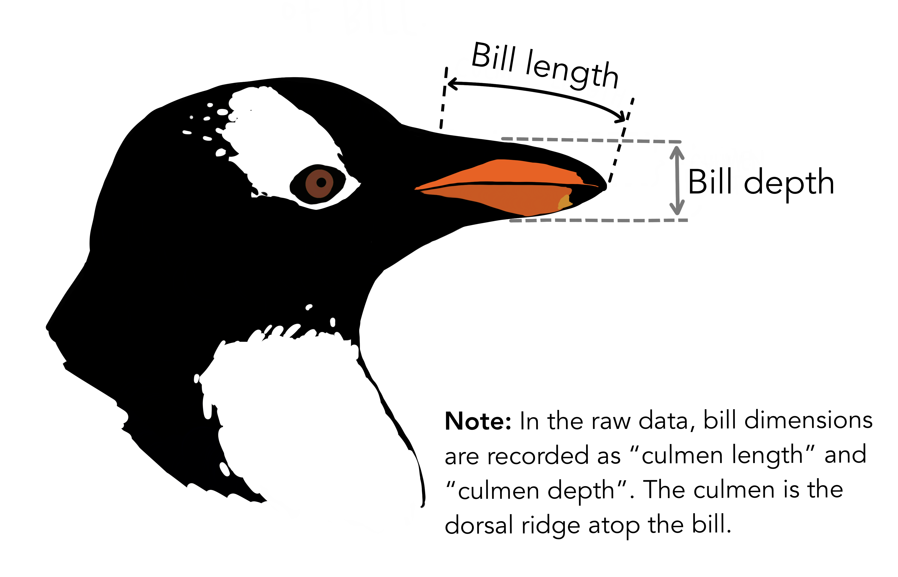
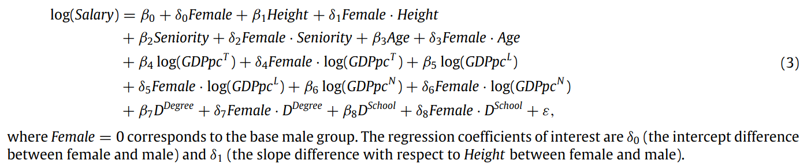
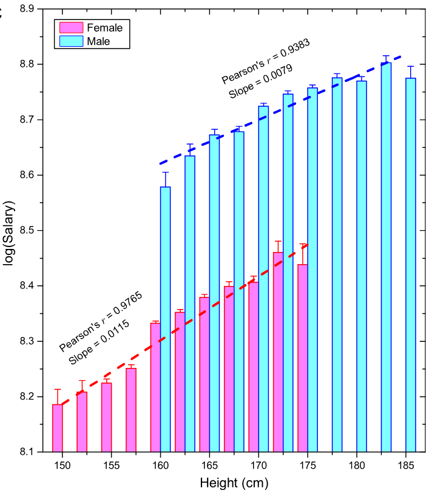
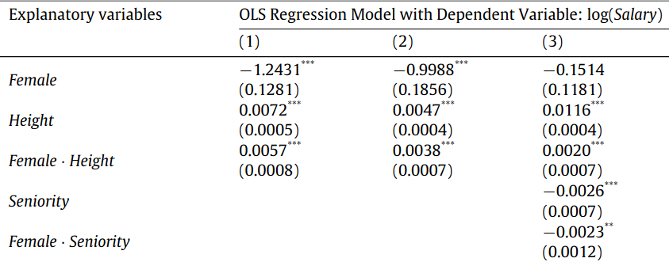

# Motivation

Linear regression is a **statistical method** used to model the relationship between:

- a dependent variable (**outcome**, a.k.a. $Y$)
- one or more independent variables (**predictors**, a.k.a/ $X_1, \dots, X_p$).

. . .

This notebook demonstrates how to use linear regression on the Palmer Penguin dataset.

## Plan

We will:

1.  Explore the dataset and understand the variables.
2.  Perform a simple linear regression
3.  Extend to multiple regression.
4.  Investigate confounding variables.

## Dataset

Let's import the usual libraries

```{python}
#| echo: true
import pandas as pd
import seaborn as sns
import matplotlib.pyplot as plt
import numpy as np
from sklearn.linear_model import LinearRegression
import statsmodels.api as sm
import statsmodels.formula.api as smf
```

and the dataset

```{python}
#| echo: true
#| output-location: slide
# Load dataset
penguins = sns.load_dataset("penguins")

# Display dataset overview
penguins.head()
```

## Reminder

{fig-align="center"}

# Quick recap

## Motivating examples

```{python}
#| width: "100%"
#| fig-align: center
# Create subplots: 1 rows, 2 columns
fig, axes = plt.subplots(1, 2, figsize=(10, 5)) 

# Bill length versus bill depth, colored by species
sns.scatterplot(y="bill_length_mm", x="bill_depth_mm", data=penguins, hue="species", ax=axes[0])
axes[0].set_title('Bill Length vs Bill Depth')
axes[0].set_xlabel('Bill Depth (mm)')
axes[0].set_ylabel('Bill Length (mm)')

# Body mass versus flipper length, colored by species
sns.scatterplot(y="body_mass_g", x="flipper_length_mm", data=penguins, hue="species", ax=axes[1])
axes[1].set_title('Body Mass vs Flipper Length')
axes[1].set_xlabel('Flipper Length (mm)')
axes[1].set_ylabel('Body Mass (g)')

# Adjust layout
plt.tight_layout()
```

. . .

::: {.callout-important appearance="minimal"}
Let's explore the relationship between those variables.
:::

## Body mass versus Flipper Length

We assume body mass ($Y$) depends on flipper length ($X$)

$$\text{body_mass_g}=β_0​+β_1​\cdot \text{flipper_length_mm}+ \varepsilon$$

where $\varepsilon \sim \mathcal{N}(0, \sigma^2)$.

. . .

::: {.callout-important appearance="minimal"}
This model makes several **assumptions**:

- body mass changes by $\beta_1$ for each additional mm in flipper length

- the change is **linear**

- the change is **always the same**, no matter the starting point

- the error term is **centered around** $0$ (weak assumption) and **gaussian** (strong assumption)

- the variability doesn't depend on flipper length.
:::

## About linear relationships

In general, we model the expectation of $Y$ conditional to $X = x$:

$$E[Y| X = x] = f(x) $$

In data science, $f$ can be a very complex function (think neural networks). It improves **predictive power** at the cost of simplicity and **interpretability**.

. . .

Here, we limit ourselves to **linear functions**:

$$f(x_1, \dots, x_p) = \beta_0 + \beta_1 x_1 + \dots + \beta_p x_p$$

## Estimating the model

We need to find the **best values** for $\beta_0$ and $\beta_1$

```{python}
#| echo: false
sns.scatterplot(
  x = "flipper_length_mm", 
  y = "body_mass_g", 
  data = penguins)
## add line
beta0_1 = -5000  # intercpet
beta1_1 = 50  # slope

beta0_2 = -6000  # intercpet
beta1_2 = 52  # slope

beta0_3 = -7000  # intercpet
beta1_3 = 55  # slope

# line coordinate
x_vals = range(170, 232)
y_vals_1 = [beta0_1 + beta1_1 * x for x in x_vals]
y_vals_2 = [beta0_2 + beta1_2 * x for x in x_vals]
y_vals_3 = [beta0_3 + beta1_3 * x for x in x_vals]

# plot the lines
plt.plot(
  x_vals, 
  y_vals_1, 
  color='red', 
  label=f'y = {beta0_1} + {beta1_1}x'
)
plt.plot(
  x_vals, 
  y_vals_2, 
  color='orange', 
  label=f'y = {beta0_2} + {beta1_2}x'
)
plt.plot(
  x_vals, 
  y_vals_3, 
  color='yellow', 
  label=f'y = {beta0_3} + {beta1_3}x'
)
plt.legend()
plt.show()
```

## Fit criteria

Our fit criteria is the **residual sum of squares** defined as

$$SS = \sum_i (y_i - \underbrace{(\beta_0 + \beta_1 x_i)}_{=\hat{y}_i})^2 = \sum_i (y_i - \hat{y}_i)^2$$

. . .

We choose $\beta_0$ and $\beta_1$ which achieve the **least residual (sum of) squares** between the predictions (points on the line) and the observations.

$$(\hat{\beta}_0, \hat{\beta}_1) = \arg\min_{\beta_0, \beta_1} \sum_{i = 1}^n (y_i - (\beta_0 + \beta_1 x_i))^2$$

::: {.callout-note appearance="minimal"}
Linear regression is sometimes called Ordinary Least Squares (OLS) for that reason.
:::

## Fit criteria

```{python}
sns.scatterplot(
  x = "flipper_length_mm", 
  y = "body_mass_g", 
  data = penguins)
## add line
beta0 = -6000  # intercpet
beta1 = 52  # slope

# segments coordinate
x_vals = penguins["flipper_length_mm"]
y_pred = [beta0 + beta1 * x for x in x_vals]

# plot the lines
plt.plot(
  x_vals, 
  y_pred, 
  color='red'
)
plt.plot(
  [x_vals, x_vals], 
  [y_pred, penguins["body_mass_g"]], 
  color='orange', 
)
plt.show()
```

## **Fi**tting

```{python}
#| echo: true
#| output-location: slide
# Drop rows with missing values
penguins_clean = penguins.dropna()

# Simple linear regression: flipper_length_mm → body_mass_g
model_simple = smf.ols(
  "body_mass_g ~ flipper_length_mm", 
  data=penguins_clean
  ).fit()

## Plot
sns.regplot(
  data=penguins_clean, 
  x="flipper_length_mm", 
  y="body_mass_g", 
  ci = None, 
  line_kws={"color": "red"}
  )
plt.title("Simple Linear Regression: Flipper Length vs. Body Mass")
plt.show()
```

## Understanding the results

```{python}
#| code-overflow: scroll
# Visualization
print(model_simple.summary2())
```

## Results interpretation

$\hat{\beta}_0$ and $\hat{\beta}_1$ are *estimated* from the data and thus come with a confidence interval.

. . .

None of the CI contains $0$ suggesting that neither $\beta_0$ nor $\beta_1$ is null.

. . .

The p-values confirm this:

- the first one tests $H_0: \beta_0 = 0$ against $H_1: \beta_0 \neq 0$

- the second one tests $H_0: \beta_1 = 0$ against $H_1: \beta_1 \neq 0$

- Both are very close to $0$.

## Results interpretation

We compute the $R^2$ to interpret model quality:

$$R^2 = 1 - \frac{\sum (y_i - \hat{y}_i)^2}{\sum (y_i - \bar{y})^2} = 1 - \frac{RSS}{TSS}$$

. . .

:::: {.callout-important appearance="simple"}
::: incremental
- TSS is the **sum of squares** in a model with no predictor:
  - everyone is predicted with the mean $\bar{y}$

  - corresponds to the overall variance of $Y$
- TSS is the **sum of squares** in a model with predictor(s):
  - corresponds to the residual variance after accounting for $X$.
- $R^2$ is the **reduction in variance** when including covariates in the model (the higher, the better the model)
- $\beta_1$ can be super significant ($p \simeq 0$) and yet the $R^2$ can be small.
:::
::::

## $R^2$ and variance

```{python}
#| fig-align: center
import pandas as pd
from sklearn.metrics import r2_score
# Set random seed for reproducibility
np.random.seed(42)

# Generate X values
X = np.linspace(0, 10, 50)

# Define the true slope and intercept
slope = 2
intercept = 5

# Generate two datasets with the same slope but different noise levels
# Dataset 1: High R^2 (low noise)
Y_high_r2 = slope * X + intercept + np.random.normal(0, 1, len(X))

# Dataset 2: Low R^2 (high noise)
Y_low_r2 = slope * X + intercept + np.random.normal(0, 10, len(X))

# Calculate R^2 values
r2_high = r2_score(Y_high_r2, slope * X + intercept)
r2_low = r2_score(Y_low_r2, slope * X + intercept)

# Combine datasets into a DataFrame
data_high_r2 = pd.DataFrame({"X": X, "Y": Y_high_r2, "Dataset": "High R²"})
data_low_r2 = pd.DataFrame({"X": X, "Y": Y_low_r2, "Dataset": "Low R2"})

# Concatenate the datasets for plotting
data_combined = pd.concat([data_high_r2, data_low_r2])

# Function to compute R² and p-value
def compute_regression_stats(X, Y):
    X_with_const = sm.add_constant(X)  # Add constant for intercept
    model = sm.OLS(Y, X_with_const).fit()
    r2 = model.rsquared
    p_value = model.pvalues[1]  # p-value for the slope
    return r2, p_value

# Compute statistics for each dataset
stats = {
    "High R2": compute_regression_stats(X, Y_high_r2),
    "Low R2": compute_regression_stats(X, Y_low_r2)
}

# Plot the datasets
g = sns.lmplot(data=data_combined, x="X", y="Y", hue="Dataset", col="Dataset", ci=None, height=5)

# Add R² and p-value to the plots
for ax, dataset in zip(g.axes.flat, ["High R2", "Low R2"]):
    r2, p_value = stats[dataset]
    annotation = f"$R^2 = {r2:.2f}$\n$p = {p_value:.2e}$"
    ax.text(0.05, 0.95, annotation, transform=ax.transAxes, fontsize=12, verticalalignment='top')

# Add a title
plt.suptitle("Datasets with Same Slope but Different R² Values", y=1.05)
plt.show()
```

## Adding another variable

Let's add `bill_length_mm` as another predictor:

$$\begin{align}
\text{body_mass_g} = & \beta_0 + \beta_1 \cdot \text{flipper_length_mm} \\
& + \beta_2 \cdot \text{bill_length_mm} + \varepsilon
\end{align}$$

```{python}
#| echo: true
# Multiple linear regression
model_multiple = smf.ols(
  "body_mass_g ~ flipper_length_mm + bill_length_mm",
  data=penguins_clean).fit()
```

## Adding another variable

```{python}
#| code-overflow: scroll
print(model_multiple.summary2())
```

## Results interpretation

- Bill length is not significant (p = 0.342, CI = \[-5.297, 15.214\])

- The regression coefficients change a bit when including another variable ($\beta_1 =$ 50.15 w/o bill length versus $\beta_1 =$ 48.89 with it)

- The $R^2$ increased (it always does) but not by much (0.763 versus 0.762) and the adjusted $R^2$ is unchanged (0.761).

. . .

::: {.callout-important appearance="simple"}
Adding bill length to the model doesn't degrade performance but doesn't improve them either.
:::

# Confounder

## Concept

**Confounding variables** are associated with both the predictor and the outcome, potentially biasing the relationship.

Here, we examine if `species` acts as a confounder.

. . .

```{python}
#| fig-align: center
# Create subplots: 1 rows, 2 columns
fig, axes = plt.subplots(1, 2, figsize=(10, 5)) 

# Flipper length versus species using a boxplot, colored by species
sns.boxplot(y="flipper_length_mm", x="species", data=penguins, ax=axes[0], hue = "species")
axes[0].set_title('Flipper Length by Species')
axes[0].set_xlabel('Species')
axes[0].set_ylabel('Flipper Length (mm)')

# Body mass versus species using a boxplot, colored by species
sns.boxplot(y="body_mass_g", x="species", data=penguins, ax=axes[1], hue = "species")
axes[1].set_title('Body Mass by Species')
axes[1].set_xlabel('Species')
axes[1].set_ylabel('Body Mass (g)')

# Adjust layout
plt.tight_layout()
```

## Adding species

```{python}
#| echo: true
# Multiple regression with species as a categorical variable
model_species = smf.ols(
  "body_mass_g ~ flipper_length_mm + bill_length_mm + C(species)", 
  data=penguins_clean).fit()
```

## Adding species

```{python}
#| code-overflow: scroll
print(model_species.summary2())
```

## Results interpretation

- Bill length becomes significant (CI = \[45.939, 74.295\])

- The regression coefficients change a lot when adding species ($\beta_1 =$ 48.89 w/o bill length versus \$\\beta_1 = \$ 27.54 with it)

- The $R^2$ increased a lot (0.824 versus 0.763) and so did the adjusted $R^2$ (0.822 versus 0.761).

. . .

::: {.callout-important appearance="simple"}
Adding species to the model drastically improves model fit (and makes bill length significant).
:::

## Results interpretation

- Species is one-hot coded (using Adelie as a reference) and there's only a effect of Chinstrap, not Gentoo (may look counterintuitive).

```{python}
sns.scatterplot(y="body_mass_g", x="flipper_length_mm", data=penguins, hue="species")
```

## Comparing models

We can compare the three models we just fitted in terms of adjusted $R^2$ as they are nested within each other (\$M_1\$ is a special case of $M_2$ when $\beta_2 = 0$, etc)

```{python}
model_flipper_species = smf.ols(
  "body_mass_g ~ flipper_length_mm + C(species)", 
  data=penguins_clean).fit()
```

```{python}
print(f"Adj. R2 (flipper): {model_simple.rsquared_adj:.3f}")
print(f"Adj. R2 (flipper+bill): {model_multiple.rsquared_adj:.3f}")
print(f"Adj. R2 (flipper+species): {model_flipper_species.rsquared_adj:.3f}")
print(f"Adj. R2 (flipper+bill+species): {model_species.rsquared_adj:.3f}")
```

## So far

- Simple regression shows the linear relationship between flipper length and body mass.

- Adding `bill_length_mm` in multiple regression adjusts the relationship but bill length alone doesn't improve the model.

- Including `species` as a confounder reveals how categorical variables impact the model.

# Interaction

## Motivation

So far, we assume the same slope for all species but it might no be the case.

```{python}
#| echo: true
#| output-location: column-fragment
sns.lmplot(
  data=penguins_clean, 
  x="flipper_length_mm", 
  y="body_mass_g", 
  hue="species", 
  ci=None
  )
plt.title("Flipper Length vs. Body Mass by Species")
plt.show()
```

## Concept

**Interaction** occurs when the effect of one predictor variable on the outcome depends on the value of another predictor.

. . .

The regression model with interaction term is $$\begin{align}
\text{body_mass_g} = & \beta_0 + \beta_1 \cdot \text{flipper_length_mm} + \beta_2 \cdot \text{species} \\
& + \beta_3 \cdot (\text{flipper_length_mm} \times \text{species}) + \epsilon
\end{align}$$

. . .

::: {.callout-important appearance="simple"}
- The interaction term ($\beta_3$​) captures how the relationship between `flipper_length_mm` and `body_mass_g` differs across species.

- It allows the model to use different slopes for different species
:::

## Adding the interaction term

The interaction is usually denoted by `*` or `:`

```{python}
#| echo: true
model_interaction = smf.ols(
  "body_mass_g ~ flipper_length_mm * C(species)", 
  data=penguins_clean).fit()
```

## Interpreting results

```{python}
print(model_interaction.summary2())
```

## Results interpretation

- Species is one-hot coded (using Adelie as a reference) and there's only a effect of Gentoo, not Chinstrap.
- The slope is the same for Chinstrap and Adelie (32.7), but is bigger for Gentoo (32.7 + 21.6 = 54.3)
- The intercept is also the same for Chinstrap and Adelie (-2508.1) but not for Gentoo (-2508.1 - 4166.1 = -6674.2)
- The adj. $R^2$ is larger than with no interaction (0.791 versus 0.785)

. . .

::: {.callout-important appearance="simple"}
The interaction term is meaningful and improves model performance
:::

## Viz

```{python}
#| echo: false
#| layout-ncol: 2
#| layout-valign: top
# Create a color palette for species
palette = sns.color_palette("deep")
species_colors = dict(zip(penguins_clean['species'].unique(), palette))

# Define a function to add user-specified regression lines
def add_custom_regression_line(data, slopes_intercepts, **kwargs):
    # Scatterplot of the data (no hue here, as FacetGrid manages it)
    sns.scatterplot(data=data, x="flipper_length_mm", y="body_mass_g", **kwargs)

    # Extract species name for the current facet
    species = data["species"].iloc[0]  # 'species' is the column being faceted
    
    # Get the slope and intercept for the current species
    intercept, slope = slopes_intercepts[species]
    
    # Generate x and y values for the line
    x = np.linspace(data["flipper_length_mm"].min(), data["flipper_length_mm"].max(), 100)
    y = slope * x + intercept

    # Get the color for the current species
    color = species_colors[species]

    # Plot the regression line in the same color as the points
    plt.plot(x, y, color=color, linestyle='--', linewidth=2)

# First Row
slopes_intercepts = {
    "Adelie": (-5872.0927, 50.153),  # Slope and intercept for Adelie
    "Chinstrap": (-5872.0927, 50.153),  # Slope and intercept for Chinstrap
    "Gentoo": (-5872.0927, 50.153)  # Slope and intercept for Gentoo
}

# Create the FacetGrid
g = sns.FacetGrid(penguins_clean, col="species", hue="species", palette=species_colors, sharex=True, sharey=True, height=2.5)

# Map the function to each facet with user-specified slopes and intercepts
g.map_dataframe(add_custom_regression_line, slopes_intercepts=slopes_intercepts)

# Add legends and titles
g.set_axis_labels("Flipper Length (mm)", "Body Mass (g)")
g.set_titles("{col_name} Species")
plt.suptitle("Simple Regression (Body Mass ~ Flipper Length)", y=1.05)
plt.show()

## Second row
slopes_intercepts = {
    "Adelie": (-4013.1789, 40.6062),  # Slope and intercept for Adelie
    "Chinstrap": (-4013.1789-205.3755, 40.6062),  # Slope and intercept for Chinstrap
    "Gentoo": (-4013.1789+284.5236, 40.6062)  # Slope and intercept for Gentoo
}

# Create the FacetGrid
g = sns.FacetGrid(penguins_clean, col="species", hue="species", palette=species_colors, sharex=True, sharey=True, height=2.5)

# Map the function to each facet with user-specified slopes and intercepts
g.map_dataframe(add_custom_regression_line, slopes_intercepts=slopes_intercepts)

# Add legends and titles
g.set_axis_labels("Flipper Length (mm)", "Body Mass (g)")
g.set_titles("{col_name} Species")
plt.suptitle("Multiple Regression (Body Mass ~ Flipper Length + Species)", y=1.05)
plt.show()

## Third row
sns.lmplot(
    data=penguins_clean,
    x="flipper_length_mm",
    y="body_mass_g",
    hue="species",
    ci=None,
    col="species",
    col_wrap=3,
    height=2.5
)
plt.suptitle("Regression with Interaction (Body Mass ~ Flipper Length *Species)", y=1.02)
plt.show()
```

## Confidence interval

The confidence interval quantifies the uncertainty associated with the distribution of $\hat{Y}_i = \hat{\beta}_0 + \hat{\beta}_1 X_i$.

It increases as $X_i$ gets further away from $\bar{X}$.

```{python}
#| layout-ncol: 2
## simple regression
sns.regplot(
  data=penguins_clean, 
  x="flipper_length_mm", 
  y="body_mass_g", 
  line_kws={"color": "red"}
  )
plt.title("Simple Linear Regression: Flipper Length vs. Body Mass")
plt.show()
## with interaction
sns.lmplot(
  data=penguins_clean, 
  x="flipper_length_mm", 
  y="body_mass_g", 
  hue="species"
  )
plt.title("Flipper Length vs. Body Mass by Species")
plt.show()
```

## Summary

- Interaction terms allow us to explore how relationships vary across groups.

- In the penguins dataset, `species` moderates the relationship between `flipper_length_mm` and `body_mass_g`.

- Visualizing interactions helps clarify complex relationships.

- Always assess whether adding interaction terms improves model performance.

# To go further

## Wage, gender and height (I)

Read and interpret the results from [this study](https://jianxgao.com/publication/yang-2018-height/yang-2018-height.pdf) about the impact of age, sex, height and seniority on wages.



## Wage, gender and height (II)

::::: columns
::: {.column width="50%"}

:::

::: {.column width="50%"}

:::
:::::

## DIY: Bill length versus Bill depth

```{python}
#| fig-align: center
sns.scatterplot(
  y="bill_length_mm", x="bill_depth_mm", 
  data=penguins, hue="species")
plt.show()
```
