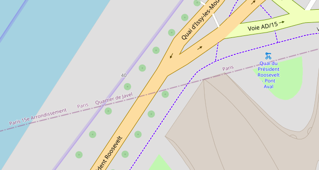
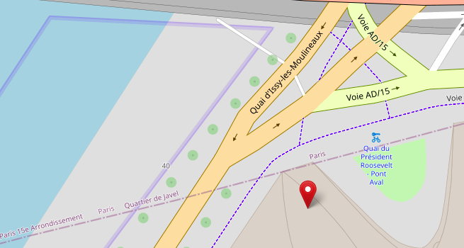
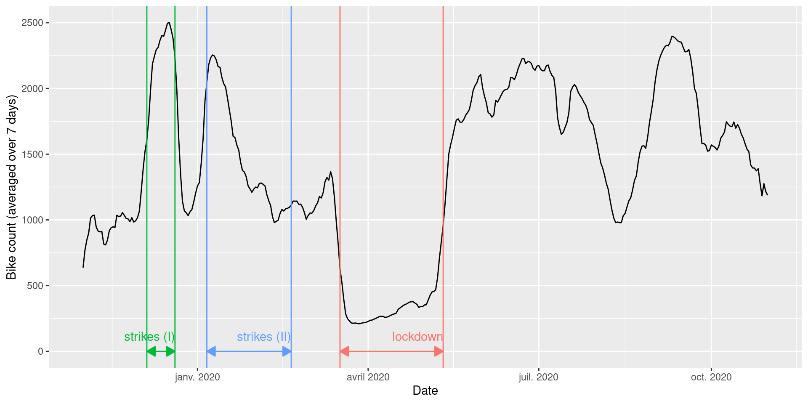
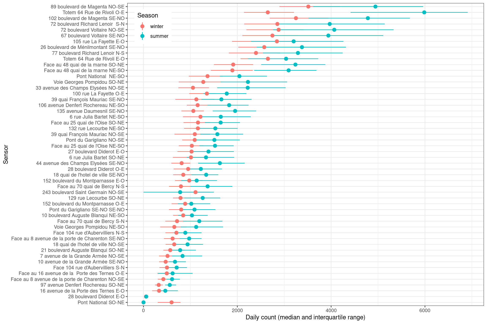

# Context

In this analysis, we're interested in biking patterns across Paris. The city hall installed sensors across Paris. Each of those sensors monitors the number of bikes passing in front of the sensor each hour. Those daily tallys were recorded from November 1st, 2019 to October 31st, 2020 (fresh data are available fromt the Paris Open Data platform but this time spans makes for some interesting stories).

We'll first describe the dataset using a few descriptive statistics before using it to study a few basic patterns:

-   are there more bikes on the streets in summer than in winter ?
-   are some biking directions more crowded than others ?
-   should I always trust my eyes ?

# Import

## Libraries

```{python}
import pandas as pd
import numpy as np
import seaborn as sns
import matplotlib.pyplot as plt
from scipy.stats import ttest_ind, ttest_rel, f_oneway, chi2_contingency
from statsmodels.stats.proportion import proportions_ztest

# For date manipulation
from datetime import datetime
```

## Data

The data are stored in three flat csv files located on the website. We import them as `counts`, `sensors` and `districts`.

```{python}
counts = pd.read_csv("data/sensor_count_data_2019.csv")
sensors = pd.read_csv("data/sensor_details.csv")
districts = pd.read_csv("data/district_details.csv")
```

Each dataset consists of tabular data with several columns.

:::::: panel-tabset
## Districts

```{python}
districts.head()
```

```{python}
districts.info()
```

`districts` has 5 variables:

-   `District`: district number
-   `District_name`: district name
-   `Surface`: district surface (in square meters)
-   `Perimeter`: district perimeter (in meters)
-   `Population`: district legal population of 2020 (as per the INSEE definition)

::: callout-note
There is no missing data in `districts`.
:::

## Sensors

```{python}
sensors.info()
```

`sensors` has 7 variables

-   `ID`: sensor unique ID
-   `Name`: sensor name (usually a location and a direction)
-   `Location_ID`: sensor location unique ID
-   `Location_ID`: sensor location name
-   `Setup_date`: date of installation (and of first hourly record)
-   `GPS_coordinates`: GPS coordinates
-   `District`: district where the sensor is located

`ID` may differ from `Location_ID` if two sensors are located in the same position but monitor flows running in opposing directions.

::: callout-note
There are missing data in all variables (but `Name`) of `sensors`.
:::

## Counts

```{python}
counts.info()
```

`counts` has 3 variables:

-   `ID`: sensor unique ID
-   `Name`: sensor name
-   `Date`, `Year`, `Month`, `Day`: date of tally (as a single string or decomposed as year, month and day)
-   `Hour`: end of the 1 hour-long tally slot (e.g. 14 means that the bike count corresponds to the 2 PM to 3 PM time slot)
-   `Bike_count`: hourly bike count

::: panel-tabset
There are missing data only the `ID` variable.
:::
::::::

# Data wrangling

## Quality checks and data correction

We perform a few sanity checks.

-   all bike counts are nonnegative

```{python}
if not (counts['Bike_count'] >= 0).all(): 
  print("Negative bike counts found!")
```

-   all districts are valid in the `districts` dataset

```{python}
## No problems in districts dataset
if not districts['District'].between(1, 20).all():
    print("Invalid district found in districts dataset!")
```

-   But some districts are invalid in the `sensors` dataset

```{python}
## Problem(s) in sensors dataset
if not sensors['District'].between(1, 20).all():
    print("Invalid district(s) found in sensors dataset!")
```

Let's check how many and which sensors have invalid districts

```{python}
sensors.loc[~sensors['District'].between(1, 20), ["ID", "Name"]]
```

We find two locations (corresponding to four sensors) with invalid districts. Some of them don't even have a sensor ID !

Let's check if we have count data for those sensors:

```{python}
weird_sensors = counts[counts['Name'].isin(["Face au 40 quai D'Issy SO-NE", "Face au 40 quai D'Issy NE-SO", "90 Rue De Sèvres 90 Rue De Sèvres  Vélos NE-SO", "90 Rue De Sèvres 90 Rue De Sèvres  Vélos SO-NE"])]
```

```{python}
# Create a FacetGrid to split the data by Name
g = sns.FacetGrid(
  data=weird_sensors, col='Name', 
  col_wrap=2, 
  sharex=True, sharey=False, 
  height=4)
g.map(sns.histplot, 'Bike_count', bins=20, color='blue', kde=False)

# Add a title to the FacetGrid
g.fig.suptitle('Histogram of Bike_count by Name', y=1.02)
g.set_axis_labels('Hourly bike count', 'Frequency')
# plt.show()
```

We do, so those are valid sensors which are not located in a district. But why is that ?

```{python}
sensors.loc[~sensors['District'].between(1, 20), ["Name", "GPS_coordinates"]]
```

For the sensors located "90 Rue de Sèvres", it's because we don't have GPS coordinates so preprocessing couldn't find its location but a [google search](https://maps.app.goo.gl/yRYU9WaPVfQ6Hez38) finds it in the 7th district.


The other sensor location ("Face au 40 quai D'Issy") could be in the 15th district...



but the GPS coordinates locate them outside of Paris so no district can be attributed to that sensor based on its location only. However, given it monitors traffic in the 15th district, we can allocate it to that district.



Let's correct the district for the (ID-less) sensor:

```{python}
sensors.loc[sensors['Name'].isin(["90 Rue De Sèvres 90 Rue De Sèvres  Vélos NE-SO", "90 Rue De Sèvres 90 Rue De Sèvres  Vélos SO-NE"]), "District"] = 7
sensors.loc[sensors['Name'].isin(["Face au 40 quai D'Issy SO-NE", "Face au 40 quai D'Issy NE-SO"]), "District"] = 15
# Check the results after correction
sensors.info()
```

We updated the district information for all sensors. The remaining missing information concern exclusively the two sensors located rue de Sèvres.

```{python}
sensors.loc[sensors['Name'].isin(["90 Rue De Sèvres 90 Rue De Sèvres  Vélos NE-SO", "90 Rue De Sèvres 90 Rue De Sèvres  Vélos SO-NE"])].info()
```

Likewise the only rows with missing data correspond to those sensors.

```{python}
## No missing data when removing the two sensors
counts.loc[~counts['Name'].isin(["90 Rue De Sèvres 90 Rue De Sèvres  Vélos NE-SO", "90 Rue De Sèvres 90 Rue De Sèvres  Vélos SO-NE"])].info()
## No ID information at all when including those two sensors
counts.loc[counts['Name'].isin(["90 Rue De Sèvres 90 Rue De Sèvres  Vélos NE-SO", "90 Rue De Sèvres 90 Rue De Sèvres  Vélos SO-NE"])].info()
```

The hourly resolution is a bit too fine and as it results in a lot of records with many small values.

```{python}
counts['Bike_count'].describe()
```

The histogram shows a lot of small values but the large spread of data makes it difficult to read

```{python}
plt.figure(figsize=(10, 6))
sns.histplot(data=counts, x='Bike_count')
plt.title('Histogram of hourly bike counts')
plt.xlabel('Hourly bike counts')
plt.ylabel('Frequency')
# plt.show()
```

Using a log_scale for x or or logarithmic bins for x makes it easier to read.

```{python}
plt.figure(figsize=(10, 6))
sns.histplot(data=counts, x='Bike_count', log_scale = True)
plt.title('Histogram of hourly bike counts')
plt.xlabel('Hourly bike counts (log-scale)')
plt.ylabel('Frequency')
# plt.show()
```

The histogram shows that almost 65,000 counts (out of 772631) consist of 0s and 1s. Although the trend is decreasing, we have "spikes" at several values.

If we limit the graph to the range (1, 100), we don't observe those spikes anymore.

```{python}
# Filter the data
filtered_counts = counts[counts['Bike_count'] <= 100]

# Plot the histogram
plt.figure(figsize=(10, 6))
sns.histplot(data = filtered_counts['Bike_count'], binwidth = 1, kde=False)
plt.title('Histogram of hourly bike counts (values up to 100)')
plt.xlabel('Hourly bike counts (log-scale)')
plt.ylabel('Frequency')
# plt.show()
```

::: callout-note
Can you think of a reason behind those spikes in the first two graphs ?
:::

## From hourly do daily counts

Instead of looking at hourly counts, we're going to look at daily counts.

Before aggregating the counts, we check that we have 24 records for each sensor for each day and if not investigate the faulty sensors.

```{python}
# Group by 'Name' and 'Date', then count the number of records in each group
group_counts = counts.groupby(['Name', 'Date']).size()

# Check for groups that do not have 24 records
invalid_groups = group_counts[group_counts != 24]

# Display the result
if invalid_groups.empty:
    print("All Name-Date groups have exactly 24 records.")
else:
    print("The following Name-Date groups do not have 24 records:")
    print(invalid_groups)

```

Hum, something is strange. Let's add an explicit column `nrecords` to `invalid_groups`. Out of the 160 invalid (sensors, date) combinations, we have a few sensors with not enough records but also 18 with 25 records !!

```{python}
# Add a new column with the group sizes
invalid_groups = invalid_groups.reset_index(name='nrecords')
invalid_groups

# Count the distribution of the number of records per group
group_distribution = invalid_groups['nrecords'].value_counts().sort_index()
# Display the distribution
print(group_distribution)

```

::: callout-note
Can you come up for a reason why we have 25 records for these sensors on that day ?
:::

```{python}
# Filter for rows where nrecords is 25
filtered_groups = invalid_groups[invalid_groups['nrecords'] == 25]

# Display the result
print(filtered_groups)
```

::: callout-note
And what about those with only 23 records ?
:::

```{python}
# Filter for rows where nrecords is 23
invalid_groups[invalid_groups['nrecords'] == 23]
```

::: callout-note
Is there something special with those two days ?
:::

::: callout-note
Why do we have more (sensor, day) combinations with only 23 records than with 25 records ?
:::

Let's look at the others incomplete (sensor, day) combinations:

```{python}
invalid_groups[invalid_groups['nrecords'] < 23]
```

Eureka, it looks like our problematic friend changed name and was corrected on 2020-09-24 !

Let's check our intuition for the NE-SO sensor

```{python}
counts.loc[counts['Name'].isin(["90 Rue De Sèvres 90 Rue De Sèvres  Vélos NE-SO", "90 Rue De Sèvres NE-SO"]) & (counts["Date"] == "2020-09-24"), ["ID", "Name", "Hour"]].sort_values(by = "Hour")
```

And likewise for the SO-NE sensor

```{python}
counts.loc[counts['Name'].isin(["90 Rue De Sèvres 90 Rue De Sèvres  Vélos SO-NE", "90 Rue De Sèvres SO-NE"]) & (counts["Date"] == "2020-09-24"), ["ID", "Name", "Hour"]].sort_values(by = "Hour")
```

Based on this observation, we're going to correct the sensor "90 Rue De Sèvres 90 Rue De Sèvres Vélos NE-SO" to "90 Rue De Sèvres NE-SO" and give it ID 100060178-101060178 (and likewise for the reverse sensor).

::: callout-note
We only need to do the correction in counts. Can you think why ?
:::

```{python}
## Correct the SO-NE sensor
counts.loc[
    counts["Name"] == "90 Rue De Sèvres 90 Rue De Sèvres  Vélos SO-NE", 
    ["Name", "ID"]
] = ["90 Rue De Sèvres SO-NE", "100060178-101060178"]
## Correct the reverse sensor
counts.loc[
    counts["Name"] == "90 Rue De Sèvres 90 Rue De Sèvres  Vélos NE-SO", 
    ["Name", "ID"]
] = ["90 Rue De Sèvres NE-SO", "100060178-102060178"]
## Check that counts has been updated
counts[
    (counts["Name"] == "90 Rue De Sèvres 90 Rue De Sèvres  Vélos SO-NE") |
    (counts["Name"] == "90 Rue De Sèvres 90 Rue De Sèvres  Vélos NE-SO")
]

```

Just to be on the safe side, we check that those two IDs are already present in `sensors`.

```{python}
sensors[sensors["ID"].isin(['100060178-102060178', '100060178-101060178'])]
```

We then update the set of invalid (sensor, date) combinations

```{python}
invalid_groups = (
  counts.groupby(['Name', 'Date'])
  .size()
  .reset_index(name='nrecords')
  .query("nrecords < 23")
)
invalid_groups
```

For this last sensor, it appears to have stopped working in the evening

```{python}
counts.loc[counts['Name'].isin(["Pont des Invalides N-S"]) & (counts["Date"] == "2020-10-14"), ["ID", "Name", "Hour"]].sort_values(by = "Hour")
```

and never went back online...

```{python}
counts.loc[counts['Name'].isin(["Pont des Invalides N-S"]) & (counts["Date"] >= "2020-10-15"), ["ID", "Name", "Hour"]].sort_values(by = "Hour")
```

We therefore remove it from the dataset before computing daily tallies.

```{python}
counts = counts[~((counts["Name"] == "Pont des Invalides N-S") & (counts["Date"] == "2020-10-14"))]
```

We're now ready to get daily tallies:

```{python}
daily_counts = counts.groupby(["ID", "Name", "Date"], as_index=False)["Bike_count"].sum()
daily_counts.info()
```

## Derived features

### Number of records

Before merging everything together, we check the number of daily records per sensor.

```{python}
sensors_ext = pd.merge(
  sensors, 
  daily_counts.groupby("ID").size().reset_index(name = "daily_records"), 
  on = "ID"
  )
```

```{python}
sns.histplot(data = sensors_ext, x = "daily_records")
plt.title('Histogram of daily records')
plt.xlabel('Number of daily records')
plt.ylabel('Frequency')
plt.show()
```

Most (54 out of the of the 95) sensors have 366 daily records but we still have 41 with less than a year worth of data. Why ?

```{python}
(
  sensors_ext
  .groupby("daily_records")
  .size()
  )
```

Most of the "early" sensors were setup before November, 1st and so they can have 366 daily records. By contrast, if a sensor is not early, it should have less than 366 daily records.

```{python}
sensors_ext["Setup_status"] = sensors_ext["Setup_date"].apply(lambda x: "early" if (x <= "2019-11-01") else "late")
sns.histplot(
  data = sensors_ext, x = "daily_records", 
  multiple = "stack", hue = "Setup_status")
plt.title('Histogram of daily records')
plt.xlabel('Number of daily records')
plt.ylabel('Frequency')
plt.show()
```

```{python}
# Cross count without adding an explicit column
pd.crosstab(
  sensors_ext["Setup_status"], 
  sensors_ext["daily_records"] >= 366
  )
```

We have one sensor which was setup early but lacks some daily records (expected) and **two** sensors which were setup late and still have full daily records. This is unexpected...

The first sensor has ID `100047550-SC`

```{python}
sensors_ext.loc[
  (sensors_ext["Setup_status"] == "early") & 
  (sensors_ext["daily_records"] <366), 
  ["ID", "Name", "Setup_date", "daily_records"]
  ]
```

and broke down or was dismantled 5 days before the end of the period.

```{python}
# Define the full range of dates
full_range = pd.date_range(start="2019-11-01", end="2020-10-31")

# Identify missing dates
missing_dates = (
  pd.Index(full_range)
  .difference(daily_counts.query("ID == '100047550-SC'")["Date"])
  )

# Output missing dates
print("Missing Dates:")
print(missing_dates)
```

The other two sensors are

```{python}
sensors_ext.loc[
  (sensors_ext["Setup_status"] == "late") & 
  (sensors_ext["daily_records"] == 366), 
  ["ID", "Name", "Setup_date", "daily_records"]
  ]
```

are the ones we already encountered several times before. It appears those two sensors started recording data before the their official setup date. Let's set those two sensors as early.

```{python}
sensors_ext.loc[
  (sensors_ext["Setup_status"] == "late") & 
  (sensors_ext["daily_records"] == 366), 
  ["Setup_status"]
  ] = "early"
```

If we update our cross count, we don't have surprises anymore:

```{python}
pd.crosstab(
  sensors_ext["Setup_status"], 
  sensors_ext["daily_records"] == 366
  )
```

### Season

Before creating the final dataset, we add the season to the dataset.

```{python}
## Function to convert date to season
def assign_season(date):
    if date <= pd.Timestamp("2019-12-21"):
        return "fall"
    elif pd.Timestamp("2019-12-21") <= date <= pd.Timestamp("2020-03-20"):
        return "winter"
    elif pd.Timestamp("2020-03-21") <= date <= pd.Timestamp("2020-06-19"):
        return "spring"
    elif pd.Timestamp("2020-06-20") <= date <= pd.Timestamp("2020-09-21"):
        return "summer"
    else:
        return "fall"

daily_counts['Date'] = pd.to_datetime(daily_counts['Date'])
daily_counts['Season'] = daily_counts['Date'].apply(assign_season)
```

## Final dataset

Before moving on the rest of the analysis, we merge the three tables together to get a full dataset.

```{python}
data = pd.merge(daily_counts, sensors_ext, on=["ID", "Name"]).merge(districts, on="District")
```

```{python}
data.info()
```

# Data exploration

## Data dimension

How many daily records and sensors do we have ?

```{python}
print("Number of records:", len(data))
print("Number of sensors:", len(sensors_ext))
```

Do we have district without sensors ?

```{python}
no_sensors = pd.merge(
  districts, 
  sensors_ext["District"], 
  on="District", 
  how="left", 
  indicator=True)
print(no_sensors[no_sensors['_merge'] == 'left_only'])
```

## Summary statistics

Let's look at the distribution of daily counts based on the season

```{python}
# Create a FacetGrid for Season
g = sns.FacetGrid(
  data, col="Season", 
  hue = "Season",
  col_wrap=4, 
  sharex=True, 
  sharey=True
  )
g.map(
  sns.histplot, 
  "Bike_count", 
  binwidth=100, 
  kde=False
  )

# Add titles and adjust layout
g.set_titles("{col_name} Season")
g.set_axis_labels("Daily Counts", "Frequency")
g.tight_layout()

# Show the plot
plt.show()
```

It looks like the four seasons are quite different in terms of riding patterns.

Let's dig down at the sensor level for a few sensors

```{python}
# Create a FacetGrid for Season
g = sns.FacetGrid(
  data[data["Location_name"] == "Totem 64 Rue de Rivoli"], 
  col="Season", 
  row = "Name",
  hue = "Season",
  sharex=True, 
  sharey=True
  )
g.map(
  sns.histplot, 
  "Bike_count", 
  bins=20, 
  kde=False
  )

# Add titles and adjust layout
g.set_titles("{row_name} ({col_name})")
g.set_axis_labels("Daily Counts", "Frequency")
g.tight_layout()

# Show the plot
plt.show()
```

## Seasonal effect

Based on our observation, there's a strong seasonal effect.

Let's compute the average daily count over *early sensors* only, and plot it over time. For better results, we reorder the season in the order fall -\> winter -\> spring -\> summer.

```{python}
daily_avg = (
    data[data['Setup_status'] == 'early']
    .groupby(['Date', 'Season'], as_index=False)['Bike_count']
    .mean()
)

sns.lineplot(data=daily_avg, x='Date', y='Bike_count', color = "black")
# Scatter plot layer
sns.scatterplot(data=daily_avg, x='Date', y='Bike_count', hue='Season', edgecolor='w', s=40)
plt.title("Daily Average Bike Count by Season")
plt.xlabel("Date")
plt.ylabel("Bike Count")
plt.tight_layout()
plt.legend(title="Season", bbox_to_anchor=(1.05, 1), loc='upper left')  
# Place the legend outside the plot
plt.show()
```

A figure actually explains what's going on: I used rolling means over 7 days to smooth out the weekly effect and highlighted periods with high impact on bike riding.

{fig-align="center"}

# Data analysis

## Winter vs Summer

It is often claimed that there are more bike on the roads in summer than in winter. We want to test that claim using only early sensors.

There are several ways to answer this question depending on the statistical unit we choose:

-   consider each couple (sensor, day) as a single unit
-   consider each sensor as a unit and average the counts over time to get one value per sensor per season
-   consider each day as a unit and average the counts over sensors to get one value per day

Each model has different assumptions and all of them are slightly wrong:

-   in the first model, you consider counts from different time points to be independent
-   in the second model, you consider sensors to be independent and to form a homogeneous population
-   in the second model, you consider days in a season to be independent

For the purpose of this tutorial (and because we didn't have time to introduce more sophisticated models), I'm going to consider model 2, where each sensor is a different unit. We have 54 full sensors indexed by $i = 1, \dots, 52$. Let's note $X_i$ its average winter count of sensor $i$ and $Y_i$ its average summer count. We consider the following (naive) stastical model:

-   The $X_i$ are i.i.d with common distribution $\mathcal{N}(\mu_W, \sigma_W^2)$
-   The $Y_i$ are i.i.d with common distribution $\mathcal{N}(\mu_S, \sigma_S^2)$

And we want to test $H_0: \mu_W \geq \mu_S$ (more bikes in winter) against $H_0: \mu_W < \mu_S$ (more bikes in summer). We use an unilateral test because our alternative is one-sided (more bikes in summer than in winter) rather than two sided (different numbers of bikes in summer and winter). This suggests using a unilateral t-test.

Before doing so, we should assess equality of variances and thus test $H_0: \sigma_W^2 = \sigma_S^2$ against $H_1: \sigma_W^2 \neq \sigma_S^2$ using a F-test. We first compute the season averages by sensors.

```{python}
season_avg = (
    data[data['Setup_status'] == 'early']
    .groupby(['ID', 'Season'], as_index=False)['Bike_count']
    .mean()
)
season_avg = season_avg[season_avg['Season'].isin(["summer", "winter"])]
```

Visual exploration suggest different variances across summer and winter (but also non normality across the data...)

```{python}
sns.histplot(
  data = season_avg, 
  binwidth = 400, 
  x = "Bike_count", 
  hue = "Season")
plt.show()
```

Let's test this (not covered in class).

```{python}
# F-test for equal variance
winter = season_avg[season_avg['Season'] == 'winter']["Bike_count"]
summer = season_avg[season_avg['Season'] == 'summer']["Bike_count"]

f_stat, p_value_f = f_oneway(winter, summer)
print("F-test for equal variance:", p_value_f)
```

Hum, its not the best fit for a t.test...

## Paired tests

One way to do better and to get rid of this nasty difference is to consider a *paired test*. We have the exact same sensors in winter and in summer. Rather than comparing the population means, we could *pair* the obsevrations and match each sensor to itself as illustrated below. The graph shows that the average bike count increases for almost every single sensor.

```{python}
# Scatter plot for points
sns.scatterplot(
  data=season_avg, 
  x='Season', 
  y='Bike_count', 
  hue = "ID", 
  legend = False)
# Line plot with group by 'ID'
sns.lineplot(
  data=season_avg, 
  x='Season', 
  y='Bike_count', 
  hue = "ID", 
  legend=False)

# Add title and labels
plt.title("Bike Count by Season")
plt.xlabel("Season")
plt.ylabel("Bike Count")
plt.tight_layout()
plt.show()
```

Pairing the samples is usually more powerful as you remove the variability due to differences between sensors. The statistical model is slightly different. Using the same notations as before, we now have:

-   The $Z_i = X_i - Y_i$ are i.i.d with common distribution $\mathcal{N}(\Delta, \sigma^2)$ (you can think about $\Delta$ as $\mu_S - \mu_W$).

and we want to test $H_0: \Delta \leq 0$ against $H_1: \Delta > 0$. We can do so using a paired t-test

```{python}
# Paired T-Test
t_stat, p_value_t = ttest_rel(summer, winter, alternative='greater')
print("Paired T-test (winter vs. summer):", p_value_t)
```

Let's compare this to a normal t-test

```{python}
# Normal T-Test
t_stat, p_value_t = ttest_ind(summer, winter, alternative='greater', equal_var = False)
print("T-test with unequal variances (winter vs. summer):", p_value_t)
```

Note that the p-value is much lower when using paired rater unpaired tests. That's a direct consequence of higher statistical power. Note also that you couldn't do this is you used any other statistical unit as you would need to pair the 90 winter days to the 94 summer days...

::: callout-note
The paired looks is exaclty a one sample test of the difference against a reference value ($0$ here).
:::

## To go further

We could try a more granular representation of the data and split the dataset by sensor rather than averaging all days within a sensor.

{fig-align="center"}

The lineplot is quite informative. We learn that different sensors not only have different "base rates" but also that the *summer versus winter* effect may have a different magnitude for each sensor (although it almost always has the same sign).

# Comparing opposed flows at a given sensor

We consider the 2 locations closest to [LPI](https://www.learningplanetinstitute.org/en/) (the University I teach at) current and former sites: `Totem 64 Rue de Rivoli` and `152 boulevard du Montparnasse`. Both locations have two sensors: one measuring the bike flow running East to West (with suffix E-O) and one measuring the flow running West to East (with suffix O-E).

We want to know if:

-   if the two bike flows are similar in rue de Rivoli
-   if the two bike flows are similar in boulevard du Montparnasse
-   if the proportion of the E-O flow in the total flow (E-O flow + O-E flow) is the same in both locations.

## Transforming the data

We first compute the total number of bikes for each of the four mentioned sensors.

```{python}
flow_data = data[data['Location_name'].isin(["Totem 64 Rue de Rivoli", "152 boulevard du Montparnasse"])].copy()
sensor_totals = flow_data.groupby('Name')['Bike_count'].sum().reset_index()

print(sensor_totals)
```

## Statistical test

We have a sample of $n_1 = 372398 + 372398 = 702489$ bikes crossing in front of the sensor located boulevard du Montparnasse. Index the bikes with $i = 1, \dots, 702489$ and note $X_i$ the direction of the bike with $X_i = 1$ if the bike runs to the West and $X_i = 0$ if it runs to the East.

We assume the following model. The $X_i$ are i.i.d with common distribution $\mathcal{B}(p_1)$. We want to test $H_0: p_1 = 0.5$ (equal bike flows in both directions) against $H_1: p_1 \neq 0.5$ (unequal bike flows). We do so using a one sample test of equality of proportion:

```{python}
## Is the proportion of E-O flow equal to 0.5 in boulevard du Montparnasse ? No, there are slightly more people bking to the West
stat, p_value = proportions_ztest(372398, 372398 + 330091, value = 0.5)
print("Test statistic for 0.5 proportion (Montparnasse):", stat)
print("Z-test for 0.5 proportion (Montparnasse):", p_value)
```

```{python}
## Is the proportion of E-O flow equal to 0.5 in rue de rivoli ? No, there are slightly more people bking to the East
stat, p_value = proportions_ztest(940686, 940686 + 1351267, value = 0.5)
print("Test statistic for 0.5 proportion (Rivoli):", stat)
print("Z-test for 0.5 proportion (Rivoli):", p_value)
```

Finally, we want to compare the flows at the two sensors. In formal terms, we test $H_0: p_1 = p_2$ (the proportions of bike running to the West are equal at both locations) against $H_1: p_1 \neq p_2$ (they're not). We do using a two samples test of equality of proportions:

```{python}
## Are the two proportions equal ? Definitely not
stat, p_value = proportions_ztest(
  [940686, 372398], 
  [940686 + 1351267, 372398 + 330091]
  )
print("Test statistic for equal proportions:", stat)
print("Z-test for equal proportions:", p_value)
```

And once again, reject the null hypothesis.

## To go further

::: callout-note
This section was first proposed by a former bachelor student. This is exactly the kind of behavior you just try to emulate when working with real life data.
:::

Something we didn't do before performing the test was look at the data. This is bad practice...

```{python}
# Create a FacetGrid for Season
flow_data["direction"] = flow_data["Name"].apply(lambda x: "Westbound" if ("E-O" in x) else "Eastbound")
g = sns.FacetGrid(
  data = flow_data,
  col="Location_name",
  hue = "direction",
  sharex=True, 
  sharey=False, 
  height=4, aspect= 1.5
  )
g.map(
  sns.lineplot, 
  "Date",
  "Bike_count"
  )

# Add titles and adjust layout
g.set_titles("Location: {col_name}")
g.set_axis_labels("Date", "Daily bike count")
g.tight_layout()

# Show the plot
plt.legend()
plt.show()
```

We see that the Westboud trend is consistent in boulevard du montparnasse all year round but that the Eastboud trend in rue de rivoli changes drastically in May-June. What may have happened ?

A quick look at the [description of sensors used](https://www.eco-compteur.com/produits/gamme-zelt/zelt-urbaine/) given by the company in charge of the deployment in Paris tells us that the data relies on the “magnetic signature of each bike wheel”, and that the measures are generally taken by a belt that reaches a maximum of 1.5 meters of length. Knowing how there is two sensors at this location (O-E and E-O), and that the cycling lane is 4m wide, everything checks out. However, since the “déconfinement” on the 11/05/2020, the rue de Rivoli has been [partially cut from car traffic](https://www.lemonde.fr/m-le-mag/article/2020/05/29/la-rue-rivoli-a-paris-champ-de-batailles_6041192_4500055.html). This means that, as can be seen on the image presented on this article, the lane previously reserved to cars has been allocated to the bike flow. As this was not the case when the sensor was put in place (2019-09-04 according to our `sensors` dataframe), the bikes passing on this newly opened lane could not have been measured by the sensors. The direction getting the lesser proportion seems to check out with that hypothesis, as this new lane allows westward traffic.

Let's investigate this.

```{python}
## Function to add status relative to first lockdown
def assign_period(date):
    if date <= pd.Timestamp("2020-03-17"):
        return "Before"
    elif pd.Timestamp("2020-03-18") <= date <= pd.Timestamp("2020-05-11"):
        return "During"
    else: 
        return "After"

rivoli_data = flow_data[flow_data["Location_name"] == "Totem 64 Rue de Rivoli"].copy()
rivoli_data["Lockdown"] = rivoli_data["Date"].apply(assign_period)
```

```{python}
g = sns.FacetGrid(
  data = rivoli_data,
  col="Lockdown",
  hue = "direction",
  sharex=False, 
  sharey=True, 
  height = 4, 
  aspect = 1.5
  )
g.map(
  sns.lineplot, 
  "Date",
  "Bike_count"
  )

# Add titles and adjust layout
g.set_titles("{col_name} lockdown")
g.set_axis_labels("Date", "Daily bike count")
g.tight_layout()

# Show the plot
g.add_legend(title="Direction", loc='upper left', bbox_to_anchor=(0.05, 0.9))
plt.show()
```

Another visualization, based on the proportion of Eastbound trips at this sensor gives an even clearer picture. 

```{python}
rivoli_data = rivoli_data.pivot(index=["Date", "Lockdown"], columns="direction", values="Bike_count").reset_index()
```

```{python}
rivoli_data["Proportion"] = rivoli_data["Eastbound"] / (rivoli_data["Eastbound"] + rivoli_data["Westbound"])
## Compute confidence intervals for the proportions
rivoli_data["n"] = rivoli_data["Eastbound"] + rivoli_data["Westbound"]
rivoli_data["sem"] = 2.575 * rivoli_data["Proportion"] * (1 - rivoli_data["Proportion"]) / np.sqrt(rivoli_data["n"])
```

```{python}
plt.figure(figsize = (10, 6))
sns.lineplot(
  data = rivoli_data, 
  hue  = "Lockdown",
  x = "Date",
  y = "Proportion"
  )
## Add ribbons for each period
for period in rivoli_data["Lockdown"].unique():
    subset = rivoli_data[rivoli_data["Lockdown"] == period]
    # Add a ribbon for the period
    plt.fill_between(
        subset["Date"],
        subset["Proportion"] - subset["sem"],
        subset["Proportion"] + subset["sem"],
        alpha=0.3
    )
# Add a horizontal dashed gray line at y=0.5
plt.axhline(y=0.5, color='gray', linestyle='--', linewidth=1)

# Add titles and adjust layout
plt.xlabel("Date")
plt.ylabel("Proportion of Eastbound trips")
plt.ylim(0.4, 0.8)
plt.tight_layout()

# Show the plot
plt.legend(title="Lockdown", bbox_to_anchor=(1.05, 1), loc='upper left')  
plt.show()
```

The ribbon (99% confidence interval around the daily proportion of Eastbound trips) shows that there is a small and non or borderline significant trend in favor of those before and during lockdown, which becomes super significant after lockdown. 

This is confirmed by a test of proportion in each period

```{python}
lockdown_counts = rivoli_data.groupby("Lockdown")[["Eastbound", "Westbound", "n"]].sum().reset_index()
lockdown_counts
```

```{python}
for i in range(3):
  stat, p_value = proportions_ztest(
    lockdown_counts.loc[i, "Eastbound"], 
    lockdown_counts.loc[i, "n"], 
    value = 0.5)
  print(f"Results {lockdown_counts.loc[i, 'Lockdown']} Lockdown")
  print("Test statistic for 0.5 proportion:", stat)
  print("Z-test for 0.5 proportion:", p_value)
```

